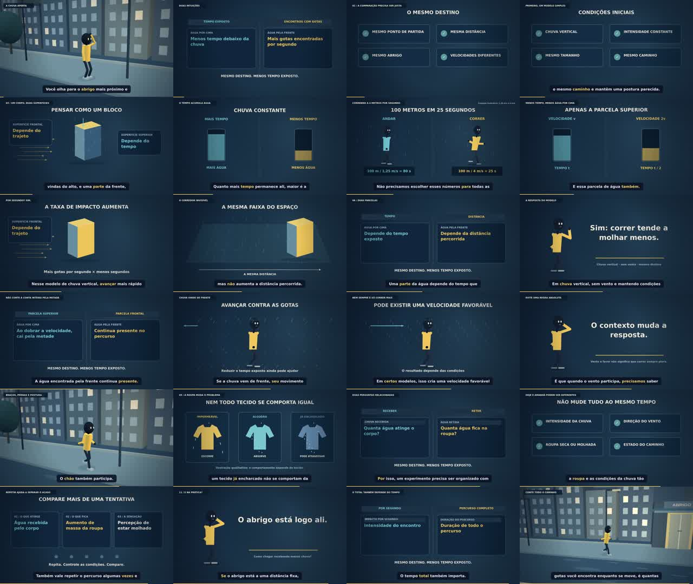

# Animação por código

## Andar ou correr na chuva? — revisão R2

Filme autoral de oito minutos. A revisão corrige a locomoção, acrescenta direção de câmera mais urgente e sincroniza os efeitos de Python aos contatos dos pés. A narração original foi preservada.

- [Filme completo — MP4 1080p / 24 fps](videos/Andar-ou-correr-na-chuva-1080p.mp4)
- [Projeto editável e instruções](projetos/andar-ou-correr-na-chuva/README.md)
- [Skill com tutorial e vídeo de exemplo](../.agents/skills/animacao-narrada-cinematica/SKILL.md)
- [Conferência técnica](projetos/andar-ou-correr-na-chuva/qa/validacao.json)

## YouTube

[Capa, título, descrição e tags do episódio](youtube/andar-ou-correr-na-chuva/README.md). Cada vídeo terá sua própria subpasta em `youtube/`.
