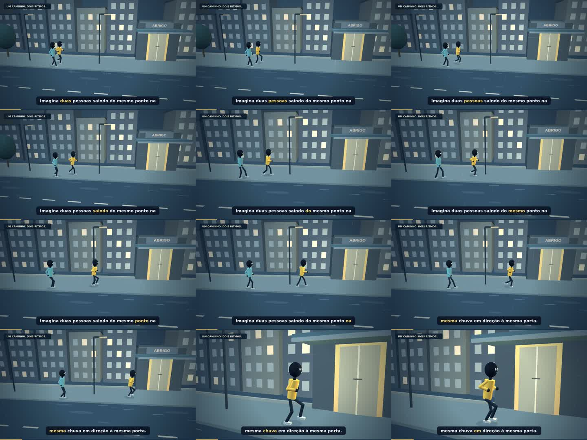

# Andar ou correr na chuva? — R2

[Filme completo — MP4 1080p, 8 minutos](../../videos/Andar-ou-correr-na-chuva-1080p.mp4) · [Skill e referências](../../../.agents/skills/animacao-narrada-cinematica/SKILL.md)

A revisão R2 corrige a caminhada e a corrida da primeira versão e acrescenta uma direção mais urgente: acompanhamento baixo, planos de contexto, aproximações e reações, respingos nos contatos e uma nova mixagem procedural. A narração enviada foi preservada.

A passada é guiada pela distância percorrida, com contatos fixos no mundo, joelhos voltados para a frente, braços em oposição, aceleração e frenagem. O mesmo sistema move os personagens 3D e os diagramas. A câmera mantém o eixo de movimento para evitar a impressão de corrida ao contrário.

O filme continua com 57 cenas-base em oito minutos, agora com subplanos nas sequências de ação. Personagens, cenário, diagramas, câmera e efeitos visuais são produzidos por código. Three.js e Canvas calculam a imagem em 1920 × 1080, a 24 fps. Não há modelos importados nem quadros dos vídeos de referência no renderizador.

## Referências

- [Tutorial de produção](https://drive.google.com/file/d/1ubyD_4pxVKIym1m511jaFqnaQyKajHSM/view?usp=drive_link)
- [Vídeo de exemplo: movimentos, câmera e dinamismo](https://drive.google.com/file/d/1anFBqRFt_goLC75ytLkMkN68qdckBA5r/view?usp=sharing)
- [Narração fornecida](https://drive.google.com/file/d/1pVOOblR-kLLD-E-TKBze0A6dF3qqco9f/view?usp=drive_link)

A skill detalha o processo, as referências, os erros encontrados e os critérios de revisão. Ela também está copiada em `skill/SKILL.md` dentro deste projeto.

## Reproduzir

Requisitos: Node >=22, Chromium, FFmpeg/FFprobe, Python 3 e NumPy. Coloque a narração MP3 original em `references/input-3`, criando a pasta. Ela não é publicada separadamente; está integrada ao filme.

```sh
cd project
npm ci
cd ..
node scripts/test-locomotion.mjs
node scripts/inspect-world.mjs
node scripts/contacts.mjs
python3 generate_sfx.py
python3 mix_audio.py
python3 render_all.py
bash assemble.sh
python3 validate_export.py
```

`CHROMIUM_PATH` seleciona o navegador. `PLAYWRIGHT_MODULE` permite indicar outro módulo Playwright. Os intermediários ficam em `render/`, ignorado pelo Git. São usados dois processos de renderização para a cota de quatro CPUs deste ambiente.

A montagem grava em um temporário exclusivo e só substitui o destino após o FFmpeg terminar. Não inicie duas montagens do mesmo trabalho simultaneamente. `OUTPUT_PATH` seleciona outro MP4 de saída e `MOVIE_PATH` seleciona o arquivo que será validado.

Para abrir o player, sirva a pasta com `python3 -m http.server 8000` e abra `project/index.html`. A reprodução e a busca do áudio controlam a animação.

## Verificação e limites



- `qa/locomocao-v2.json`: deslocamento, orientação, comprimentos e apoio em mais de 21 mil amostras.
- `qa/reuso-cache-v2.json`: prova de equivalência dos movimentos fora dos dois planos refeitos após o ajuste da faixa de apoio. A base histórica em `qa/bases/` é apenas uma referência de comparação, não é carregada pelo player.
- `qa/meshes-locomocao-v2.json`: posições dos sapatos e comprimentos dos segmentos efetivamente posados no Three.js.
- `audio/contatos-v2.json`: eventos usados para sincronizar os passos e respingos sintetizados em Python.
- `qa/validacao.json`: duração, resolução, quadros, pico de áudio, hashes e decodificação integral do MP4.

Os gráficos são explicativos e as comparações de volume são qualitativas. Os valores de tempo ilustram 100 m a 1,25 m/s e 4 m/s. A conferência por testes, quadros e trechos não equivale a revisão humana de cada frame nem a escuta humana completa. A primeira versão permanece no histórico do Git.
