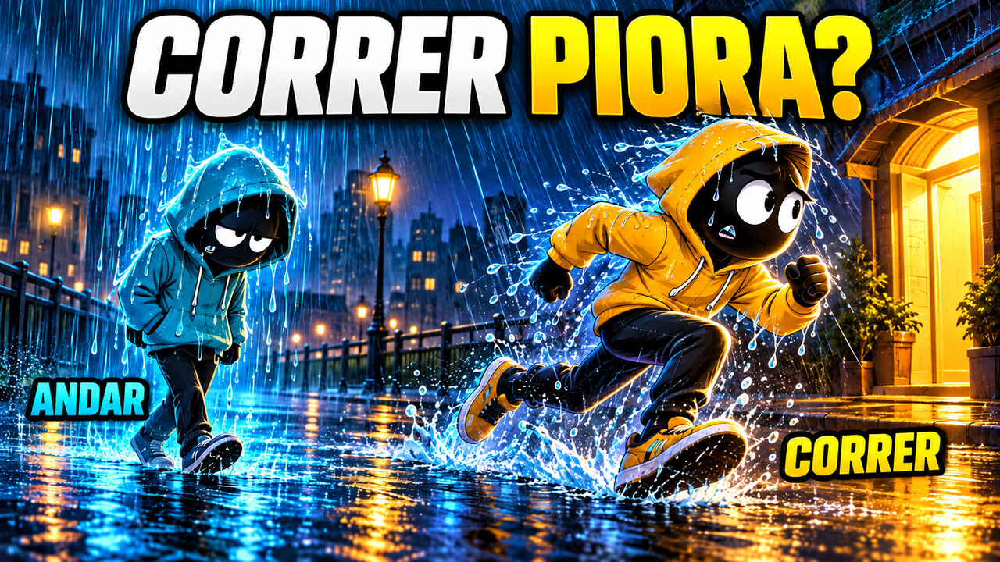

# YouTube — Andar ou correr na chuva?

**Título:** Mais gotas, menos tempo: é melhor andar ou correr na chuva?

- `capa.jpg`: versão de upload, 1280 × 720, abaixo de 2 MB.
- `capa-original.png`: imagem gerada em resolução original.
- [Título para copiar](titulo.txt)
- [Descrição com capítulos](descricao.txt)
- [Tags separadas por vírgula](tags.txt)
- [Metadados estruturados](metadados.json)
- [Filme completo](../../videos/Andar-ou-correr-na-chuva-1080p.mp4)

A capa contrapõe o tempo sob a chuva e o impacto das gotas: o personagem ciano anda encharcado, enquanto o amarelo corre para o abrigo. O contraste frio/quente e a pergunta curta seguem a linguagem das referências enviadas, com uma composição original, sem copiar marcas ou a interface do YouTube.

O título acrescenta o paradoxo “mais gotas, menos tempo” à pergunta da capa. A descrição entrega a explicação prometida e explicita as condições do modelo, sem transformar uma ilustração em um experimento real. Os capítulos correspondem aos tempos da versão R2.

Pacote preparado para publicação; nenhum upload ao YouTube foi realizado.
