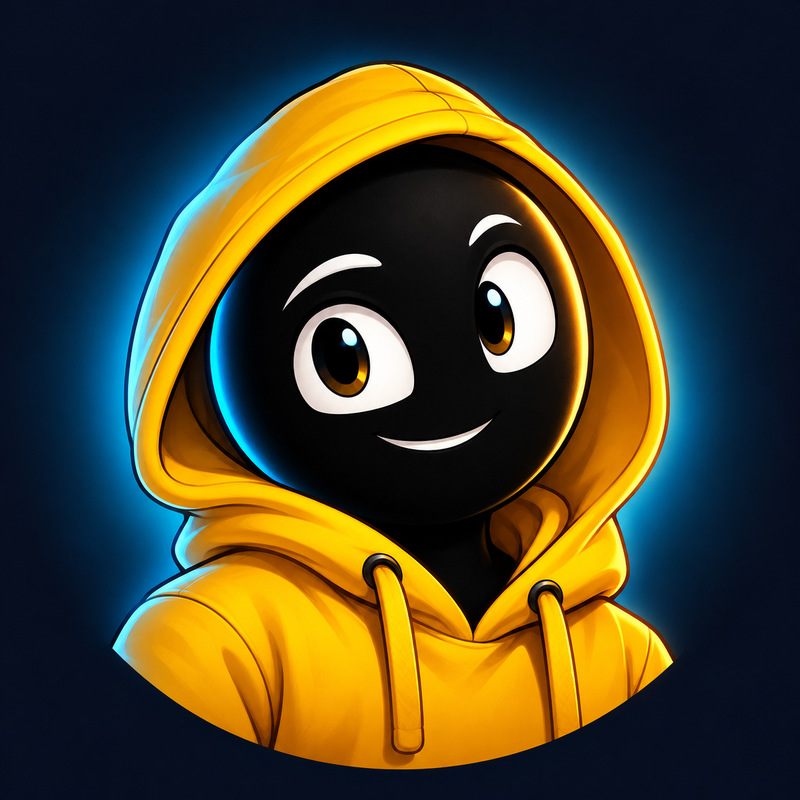

# Identidade do canal

Personagem original de cabeça escura e moletom amarelo, com expressão curiosa e amigável. A luz ciano mantém a ligação visual com a capa do episódio da chuva.

- `foto-de-perfil.jpg`: 800 × 800, pronta para upload.
- `avatar-original.png`: original em resolução maior.

O enquadramento privilegia rosto e capuz, com fundo limpo e espaço para o recorte circular. Não inclui nome ou letras para manter a leitura em tamanhos pequenos.

Para conservar a identidade nas próximas capas, mantenha a cabeça escura, os olhos expressivos, o moletom amarelo e o contraste com ciano. Poses e expressões podem mudar conforme a história.

## Banner e descrição

- `banner-youtube.jpg`: 2560 × 1440, pronto para upload no YouTube. Fundo azul-escuro, mascote e motivos de ciência concentrados no centro para os recortes entre dispositivos. Confira a prévia de recorte no YouTube antes de salvar.
- `banner-original.png`: arte original do banner.
- `descricao-do-canal.txt`: apresentação em português, pronta para copiar no campo de descrição do canal.

A proposta editorial é explicar ciência por meio de animações e perguntas instigantes: universo, natureza, corpo humano, tecnologia e fenômenos cotidianos. Kurzgesagt é uma referência de comunicação científica mencionada pelo criador; o mascote e a identidade deste canal são próprios. O banner não depende de um nome de canal e não contém texto.
