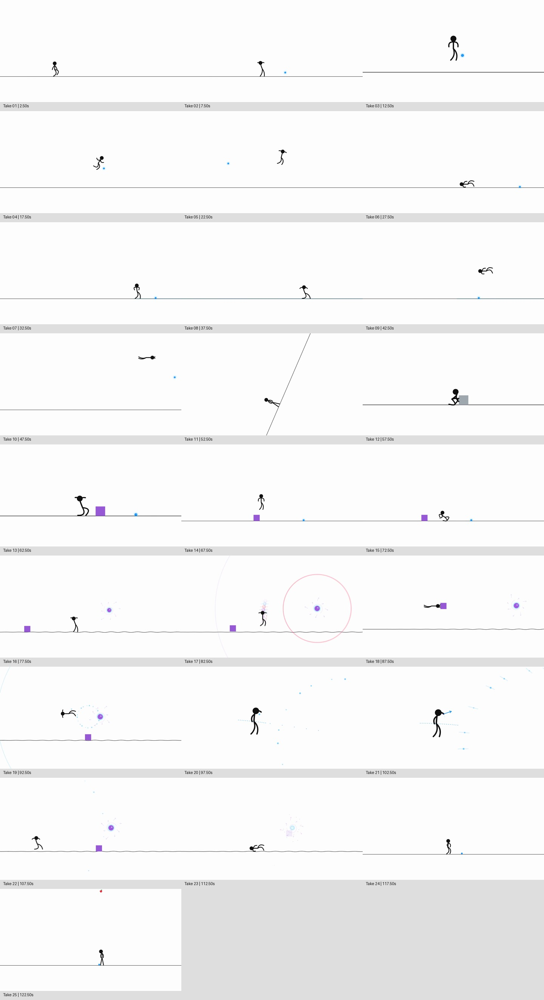

# Animation vs. Physics

Animação original inteiramente programada: **25 takes × 5 segundos = 2min05s**, **1920×1080**, **24 fps**, **3.000 frames**, MP4 H.264/AAC. Cenas, personagem, objetos, efeitos e trilha são produzidos por código. Não há imagens de referência vetorizadas, filmagem mascarada nem vídeo gerado por IA.

## Assistir e baixar

- [Filme completo — MP4 1080p](exports/animation-vs-physics-1080p24.mp4?raw=1)
- [Filme completo — MP4 720p, mais leve](exports/animation-vs-physics-720p24.mp4?raw=1)
- [Projeto editável completo — ZIP](exports/codigo-animation-vs-physics-final.zip?raw=1)
- [Prévia 01–06](exports/previa-takes-01-06-720p24.mp4?raw=1) · [Prévia 07–15](exports/previa-takes-07-15-720p24.mp4?raw=1) · [Prévia 16–25](exports/previa-takes-16-25-720p24.mp4?raw=1)
- [Relatório de compatibilidade, física e validação](RELATORIO.md)

O ZIP contém fontes, trilha pronta, backups e relatórios; os MP4s e `checksums-final.json` ficam disponíveis separadamente no repositório. O player por código funciona com o conteúdo do ZIP.

As duas primeiras prévias documentam revisões intermediárias. O filme completo inclui o refinamento posterior de gestos, câmera, contatos, áudio e exposição dos movimentos rápidos. Os links de cada revisão também permanecem nos commits anteriores da mesma branch.

## Preservação dos bonecos

`vendor/rig-controller.js` é uma cópia byte a byte do controlador fornecido. As quatro funções originais de desenho em `src/legacy-renderer.js` foram copiadas literalmente; apenas os bindings e dados de entrada são novos. `preserved/base-original/` contém a base fornecida, e `preserved/previous-system/` guarda 34 arquivos do sistema anterior. Os arquivos ativos do projeto anterior também permanecem intactos. Testes SHA-256 verificam essa preservação.

O pacote fornecido não contém `motion-data.js` nem o perfil capturado do exemplo. Reutilizamos o perfil **G** existente no projeto anterior, com seus comprimentos e proporções originais. A conversão constante de unidades **0,72** produz uma figura de aproximadamente 170 pixels. A nova instância é preta, conforme o roteiro. Não há escala animada, alteração do comprimento dos ossos ou substituição do rig; a compressão acontece por dobras das juntas. A câmera opera separadamente.

## Executar no ambiente de nuvem

Ambiente validado: Linux, Node 24, Chromium em `/usr/bin/chromium`, FFmpeg 7.1 e Python com NumPy/Pillow. Não é necessário executar ou instalar nada no computador de trabalho para assistir aos MP4s.

```bash
npm ci
python3 -m venv .venv
.venv/bin/pip install -r requirements.txt
npm test
npm run serve
```

O servidor de prévia usa a porta 4173. Abra o endereço encaminhado pelo ambiente; o player possui reprodução, busca e áudio original incluído em `exports/soundtrack.m4a`. Os scripts de inspeção e render abrem e fecham seus próprios servidores/navegadores.

Para reproduzir a exportação:

```bash
node scripts/inspect.mjs .qa/inspection
.venv/bin/python scripts/audio.py --events .qa/inspection/report.json --duration 125 --output exports/audio.wav
node render.mjs --duration 125 --audio exports/audio.wav --output exports/animation-vs-physics-1080p24.mp4
python3 scripts/validate-export.py exports/animation-vs-physics-1080p24.mp4 --duration 125
.venv/bin/python scripts/review-export.py exports/animation-vs-physics-1080p24.mp4
```

O WAV é regenerável e não acompanha o ZIP; a trilha AAC pronta está incluída. O renderizador exporta o vídeo completo mesmo quando o player é buscado em outra posição. Não depende de Drive, tokens, serviços de geração de vídeo ou ativos remotos.

## Editar e reutilizar

| Módulo | Responsabilidade |
|---|---|
| `src/director.js` | Estado persistente, takes 01–06 e simulação determinística |
| `src/act-02.js` | Takes 07–15: gelo, parede, elasticidade, câmera lateral e cubo |
| `src/act-03.js` | Takes 16–25: caos, agarre, chute duplo, partículas, plano e final |
| `src/rig-adapter.js` | Novas poses e IK que alimentam o FK original, com comprimentos fixos |
| `src/physics.js` | Passo fixo 1/120 s, massa positiva, gravidade, impulsos, atrito e planos |
| `src/collisions.js` | Contatos personagem–cubo na base de coordenadas da cena |
| `src/camera.js` | Enquadramento, zoom e rotação independentes da gravidade |
| `src/effects.js` | Ondas, símbolos, partículas, rachaduras, maçã e flashes procedurais |
| `src/shutter.js` | Exposição curta e determinística apenas em movimentos rápidos |
| `scripts/audio.py` | Instrumentos e efeitos sonoros originais, seed 20261015 |

Cada `at(tempo, ação, nome)` é um evento absoluto em segundos. Modifique os módulos novos e acrescente poses sem substituir o controlador, as funções originais de desenho ou os backups. Para outra história, crie um diretor separado e reutilize o adaptador e o solver. Leia também `docs/LEIA_PRIMEIRO.md`, `docs/SKILL.md` e `AGENTS.md`.

## Validação

`npm test` verifica preservação, ossos, contatos, determinismo, física, coreografia e roteiro. Os relatórios em `exports/` incluem:

- `simulation-validation.json`: 15.001 estados a 120 Hz, proporções e contatos;
- `story-validation.json`: 25 takes, três ondas, cubo invertido, câmera lenta e desfecho;
- `animation-vs-physics-1080p24.validation.json`: codec, resolução, fps, duração, frames e decodificação completa;
- `encoded-review.json`: inspeção de 76 frames do MP4, transições, flash, preto final e silêncios;
- `final-render-source-hashes.json`: fontes usadas no render;
- `checksums-final.json`: tamanhos e SHA-256 dos entregáveis.


