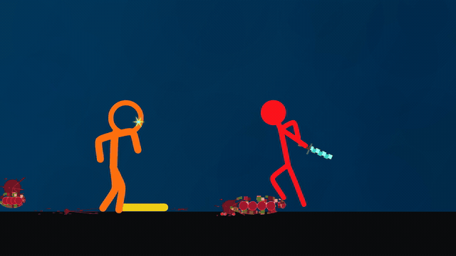

# Animação refinada — revisão 2

**[Baixar o MP4 completo, em 1080p a 60 fps](recriacao-elastica-refinada-v2-1080p60.mp4)**

- [Projeto atualizado em código](codigo-recriacao-elastica-v2.zip)
- [Skill atualizada para outros chats](skill-reference-animation-v2.zip)

## O que mudou

As proporções agora vêm de poses neutras claras da referência, e os comprimentos dos ossos permanecem estáveis. Mudanças de câmera preservam a escala do corpo inteiro. Arcos de braços e efeitos não produzem mais cabeças gigantes nos trechos corrigidos. Pés e mãos parcialmente visíveis não recebem um corpo inventado.

A identidade de cada pé agora acompanha seu alvo e peso de contato quando as pernas trocam de ordem. Os pés preservam os pontos medidos na referência, sem serem puxados para a borda escura do cenário. Contatos fora de alcance não alongam braços ou pernas. Os efeitos luminosos também foram recalculados depois da correção das cabeças. Curvas limitadas mantêm o estilo flexível e evitam laços e extrapolações. A mão que segura uma arma mantém sua identidade dentro do plano.

Os close-ups e a passagem em que o laranja está deitado receberam anotações de articulações específicas. A captura das cabeças também considera os arcos que ficam visíveis quando uma arma encobre a face.

## Prévia animada

Esta prévia reúne os trechos de 9–12 s e 69–70 s, em resolução e fps menores. Use o MP4 para avaliar a fluidez a 60 fps. Abra um arquivo e use **Download raw file / Baixar arquivo bruto** no GitHub se necessário.

## Verificação e limites

Os testes percorrem o filme a 60 fps e verificam proporções, continuidade dos rigs, contatos rígidos, cabeças antes detectadas com escala errada, curvas dobradas e poses parciais. A regressão dos contatos reproduz a troca incorreta na versão anterior e passa na revisão.

O renderer desenha a cena por código, a partir de articulações 2D nomeadas e objetos procedurais. Não utiliza o vídeo original como fundo, nem carrega frames ou imagens extraídas. A trilha original é preservada. Poses ocultas e detalhes do cenário continuam aproximados; esta é uma animação dirigida pela referência. Relatórios estão no projeto ZIP, e os checksums dos arquivos estão em `checksums.json`.

## Skill portátil

Extraia o ZIP da skill e anexe `SKILL.md` junto do novo vídeo no outro chat. Peça: “Use a skill reference-animation para recriar esta referência em código.” A base contém as correções da revisão 2; calibrações, personagens e anotações devem ser adaptados ao novo vídeo. Anexar as instruções não registra automaticamente a skill na interface.

O MP4 completo passou pela decodificação integral: 5676 frames, duração 94,6 s. Os 4074 pacotes AAC são idênticos aos da referência.
