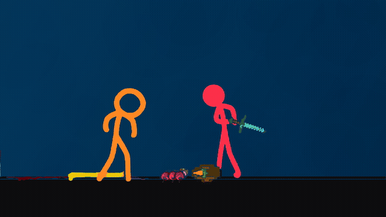

# Recriação V3 refinada

[Baixar/abrir o MP4 em 1080p e 60 fps](recriacao-elastica-refinada-v3-1080p60.mp4?raw=true)

[Projeto editável](codigo-recriacao-vetorial-v3.zip?raw=true) · [Skill atualizada](skill-reference-animation-v3.zip?raw=true)

Esta versão troca a inferência ambígua de ossos por **rotoscopia vetorial medida**.
Os contornos da referência foram analisados offline e cada quadro é redesenhado
por Canvas, com curvas arredondadas, pequena expansão de espessura, nova paleta
e interpolação por fluxo óptico. O player contém caminhos vetoriais, não o vídeo
original nem frames/máscaras raster. Isso não é uma coreografia manual nova ou
uma simulação física autônoma. O fundo azul é gerado por código.

Foram corrigidos membros trocados, corpos completados fora da câmera, escala
inconsistente e intervalos que apagavam personagens no início e no final.
Armas, paciente, cama e outros objetos conservam os contornos medidos.

A comparação de 65 silhuetas visíveis teve IoU médio de 0,9196 (V2: 0,3536).
Esse resultado mede a projeção em amostras; não prova anatomia escondida ou
física independente. As prévias rápidas, os planos cortados e o final foram
conferidos no MP4. O arquivo completo foi decodificado sem erros e os pacotes
AAC foram preservados integralmente. Limites: pequenas bordas de compressão,
paleta reduzida dos objetos e interpolação de movimentos muito rápidos.

Os pacotes contêm instruções de uso e relatórios. A skill pode ser anexada em
um novo chat como instrução; registro persistente depende do aplicativo.
