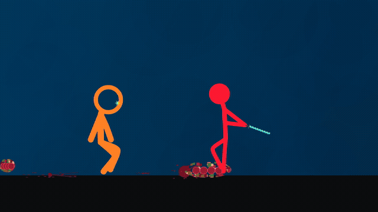

# V4 — personagens e movimentos criados por código

[Baixar/abrir o MP4 1080p/60 fps](recriacao-codigo-v4-1080p60.mp4?raw=true)

[Projeto editável](codigo-rig-v4.zip?raw=true) · [Skill atualizada](skill-reference-animation-v4.zip?raw=true)

Esta versão retoma o método solicitado: rig próprio, 33 poses-base, 176 keyframes,
curvas arredondadas, IK para contato, gravidade, arrasto e molas amortecidas.
Não usa silhuetas extraídas, contornos vetorizados, máscaras, fluxo óptico ou o
vídeo original como camada visual. A posição/escala e a sequência são calibradas
pela referência. Os modelos geométricos e movimentos são editáveis em código.
O áudio original foi preservado integralmente.

Foram acrescentados controles de caminhada, bloqueio da lâmina, contato com o pé,
golpes no alvo, soltura contínua e queda da espada, planos cortados, dano por
impacto e retorno dos personagens no final. Armas seguem a mão; o modelo 2.5D
mantém comprimentos anatômicos 3D constantes. Projeção 2D, perspectiva e câmera
podem mudar a aparência sem alterar os comprimentos 3D.

Os testes conferem o rig em toda a duração, contato das armas, três golpes no alvo,
soltura sem teleporte, partes cortadas, final e controles. Prévias codificadas foram
conferidas visualmente. O MP4 completo foi decodificado sem erro e todos os pacotes
AAC foram preservados. Isso não é reprodução pixel a pixel: parte da coreografia
e os detalhes do cenário permanecem aproximações feitas com modelos próprios.

A skill mantém o método de rig/keyframes e orienta a não substituí-lo por
vetorização. Pode ser anexada como instrução em outro chat; registro persistente
depende do aplicativo. Não inclui credenciais ou a referência visual original.
