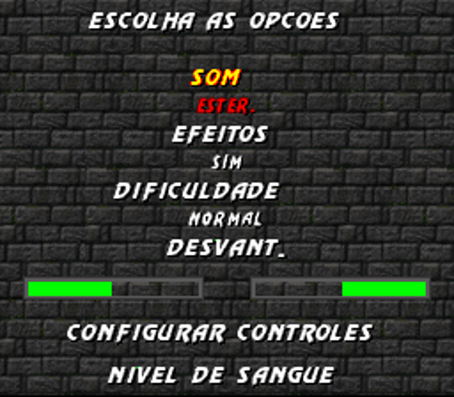
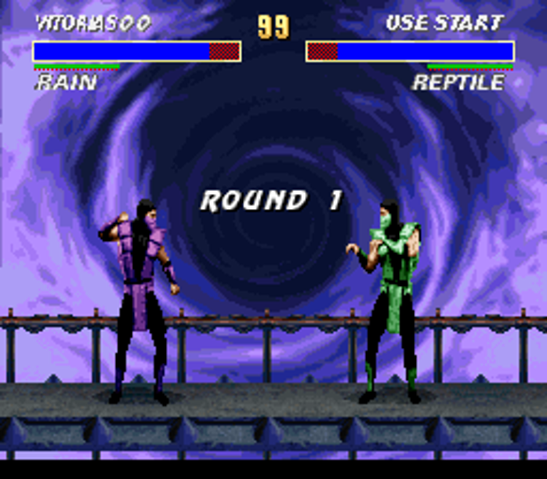

# Ultimate Mortal Kombat 3 — PT-BR, alfa R2

[Baixar a ROM .smc](UMK3-PTBR-ALFA.smc). Abra o arquivo no GitHub e use **Download raw file / Baixar arquivo bruto**. Carregue a ROM diretamente no emulador, começando uma partida nova em vez de restaurar um save state antigo.

## Mudanças desta revisão

- O valor **SIM** aparece completo nos menus: sete referências ao antigo ON foram redirecionadas para uma nova string. Não é mais a abreviação S.
- O texto gráfico **WINS:** do placar passou a **VITORIAS**.
- O convite gráfico **PRESS START** da luta passou a **USE START**.
- A imagem **DANGER** foi redesenhada como **PERIGO**; sua aparição em uma situação real de pouca vida ainda não foi conferida.

O bloco gráfico foi decodificado, editado e recomprimido dentro do espaço original. Não houve substituição do cenário nem dos personagens.





## Verificação e limites

A ROM mantém 4 MB, mapeamento HiROM, ausência de cabeçalho de copiador e checksum válido. Inicialização, menus e uma partida nova foram conferidos no núcleo Snes9x. Foram executados mais 3600 frames, passando por duas rodadas, derrota, continuação e fim de jogo. A reconstrução independente gera a mesma ROM e o mesmo patch IPS, byte por byte.

**A tradução continua parcial.** ROUND, os avisos grandes de vitória como REPTILE WINS e outras chamadas de combate ainda estão em inglês. Também faltam textos de história, finais e outras imagens. A fonte original dos menus continua sem acentos. Não houve teste direto no ZSNES nem campanha completa.

O [patch IPS](UMK3-PTBR-PARCIAL.ips) é uma alternativa à ROM pronta. Aplique-o somente à ROM original USA, sem cabeçalho, indicada pelo SHA-256 no [manifesto](qa/translation-manifest.json).

## Reconstruir

Requisitos usados: Python 3.12, NumPy, Pillow e a fonte `/usr/share/fonts/truetype/dejavu/DejaVuSans-BoldOblique.ttf`. Forneça a ROM original separadamente; ela não está incluída nesta pasta.

```sh
python3 tools/build_translation.py --rom /caminho/original.sfc --out /tmp/umk3-ptbr
```

O script verifica o hash da entrada e gera ROM, IPS e manifesto. A aplicação independente do IPS e a validação do checksum fazem parte da construção. Não houve decompilação/recompilação completa do programa: esta é uma modificação binária de textos e de um recurso gráfico comprimido.
