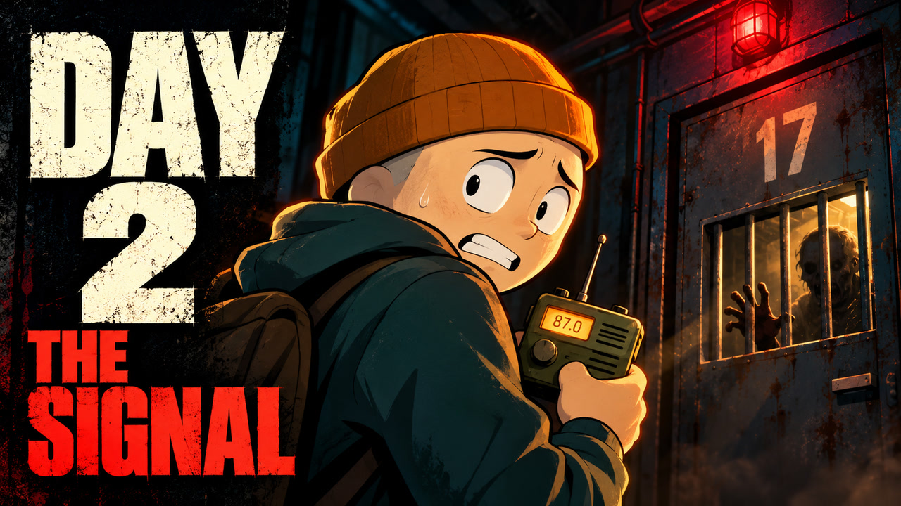

# YouTube upload — Episode 2

## Title

Day 2 of the Zombie Outbreak — The Signal Was a Warning

## Description

A mysterious radio broadcast leads a small group of survivors toward Block 17. But beneath a school, repeated knocks and a chilling warning turn their search for shelter into a fight to escape.

## Thumbnail

[Upload this JPG](capa/day-two-thumbnail.jpg) — 1280 × 720, 16:9, under 2 MB.

## Production note

Original promotional illustration generated from the creator's Day 1 cover and the actual Day 2 video reference. The orange beanie, teal hoodie, radio frequency 87.0 and door 17 connect the cover to the episode. The cover is an illustration, rather than a frame captured from the film. The title and description preserve the final reveal.

Packaging followed the vidIQ packaging studio skill, using the supplied references and story. The illustration was created with the image generation tool and visually checked at 320 × 180 for mobile readability.
