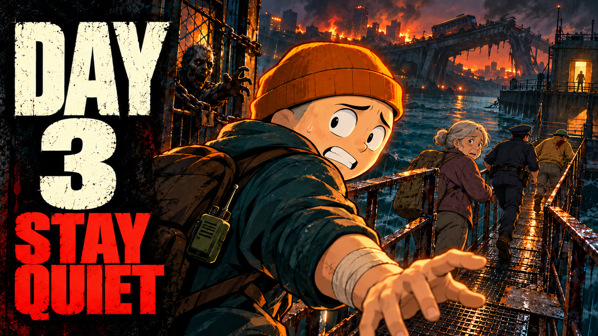

# YouTube upload — Episode 3

## Title

Day 3 of the Zombie Outbreak — Someone Was Listening

## Description

Rosa's voice leads four survivors toward a dangerous crossing while the city collapses around them. Beyond the canal, a false evacuation message forces them to choose between staying hidden and warning everyone else.

Would you stay quiet or break the silence? Tell us in the comments.

## Thumbnail

[Upload this JPG](capa/day-three-thumbnail.jpg) — 1280 × 720, 16:9, under 2 MB.

## Production note

The thumbnail follows the creator's Day 2 identity: orange beanie, teal hoodie, ivory episode number and red supporting text. The chained gate, bandaged arm, canal crossing and damaged bridge reflect this episode. The three companions retain their established roles; Rosa is at the relay shelter. This is an original promotional illustration, rather than a captured frame. Packaging followed the vidIQ packaging studio skill using the supplied story and cover references.
